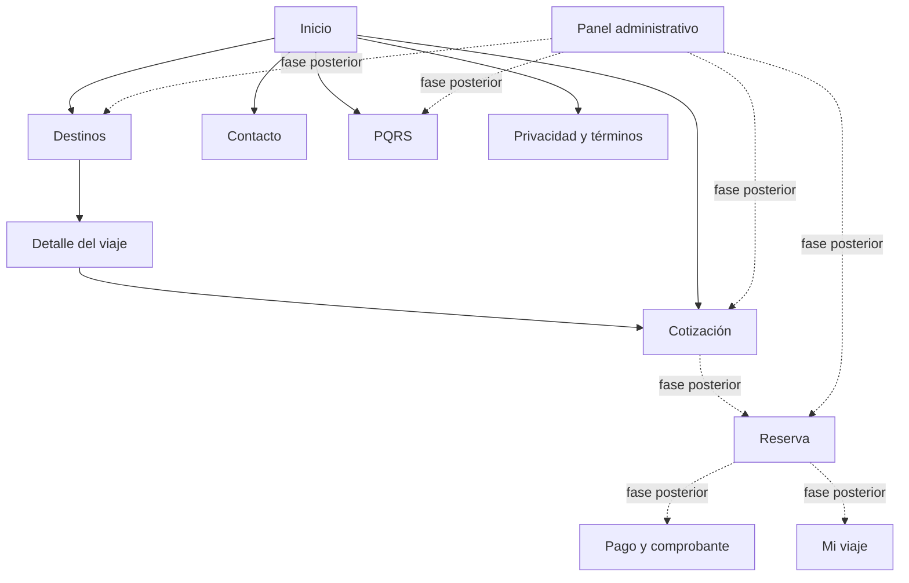
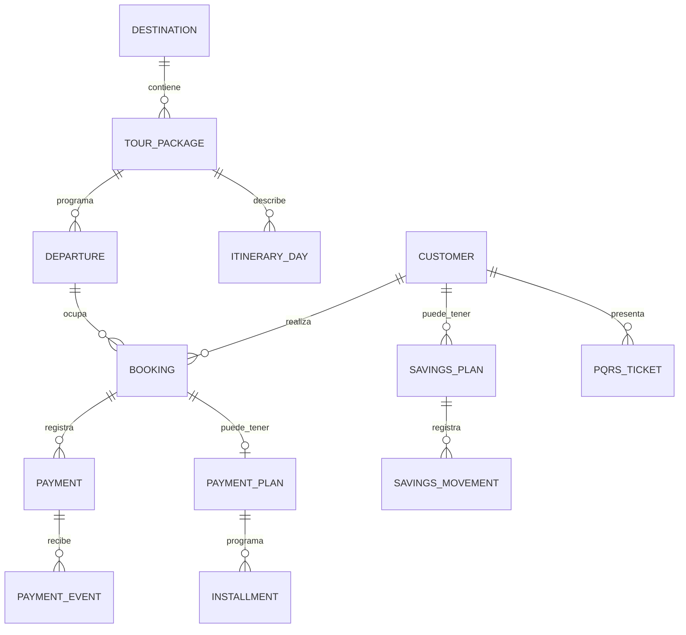

# Propuesta inicial · Ricaurte Tours

Fecha: 15 de octubre de 2026. Esta propuesta diferencia hechos comprobados, conceptos visuales y decisiones por validar.

## Diagnóstico de referencias

- La [página inicial de Turismo Andino](https://turismoandinopasto.com/) presenta categorías de viajes, buscador, destinos destacados, información sobre Plan Separa y ahorro programado, FAQ, contacto y PQRS. Su [ficha de Atacames](https://turismoandinopasto.com/destino/atacames) presenta fechas, precios, inclusiones, galería y formulario. Esto confirma que un visitante necesita ver las condiciones de una salida junto al viaje, antes de iniciar una reserva.
- Oportunidad de experiencia: unificar búsqueda, detalle, cotización y futura reserva en un flujo con una sola captura de datos; separar con claridad ideas de viaje de salidas confirmadas, y Plan Separa de cualquier programa de ahorro. Son propuestas de diseño, no una evaluación técnica completa del sitio de referencia.
- La página general de [Facebook de Ricaurte Tours](https://www.facebook.com/ricaurtetours) no entregó sus álbumes. El cliente aportó enlaces a siete publicaciones concretas; sus incrustaciones públicas sí permitieron verificar textos y fotografías. Se identificaron viajes realizados al [Eje Cafetero en 2026](https://www.facebook.com/ricaurtetours/posts/pfbid02qekU9VFtujNEhXBo1NDofAwCF7KdP7sw6EuRy6HYVjBsg67qAUGm551KMeymmjFgl), [Atacames en 2025](https://www.facebook.com/ricaurtetours/posts/pfbid024bTj1rCqxL4D27wYoouNGbTe87HBtVcer3wTQ5sSfnncZRhgC5J4jRbfHHrm5vaNl) y la [Excursión Chévere 2024](https://www.facebook.com/ricaurtetours/posts/pfbid0EV2uYFLFLoME96q6fWpeP52ft68sFeVyfWfVg3Z7BJvLoAh9gT5GdkcnRZGpXLa2l). Los anuncios de San Andrés y Atacames de 2025 no se usaron como evidencia de salidas actuales. Hay registros públicos de otra agencia con nombre parecido en Nariño; no se mezclaron sus datos con esta página.

### Lectura visual de Turismo Andino

| Elemento observado | Aplicación en Ricaurte Tours |
| --- | --- |
| Encabezado blanco con navegación por servicios | Navegación clara con logo real, destinos, experiencias, planes, preguntas y PQRS. |
| Hero inmersivo y buscador protagonista | Imagen propia con destino, fecha tentativa y viajeros; los datos pasan al formulario de cotización. |
| Tarjetas de destinos y categorías | Tarjetas y filtros propios con viajes pasados verificados en las publicaciones; se distinguen de cualquier oferta vigente. |
| Bloques Plan Separa / ahorro programado | Presentación separada, con estado pendiente y sin activar operaciones financieras. |
| FAQ y llamada a la acción final | Preguntas que describen honestamente el estado del prototipo. |

La hoja de estilos pública de la referencia usa Rubik y Caveat y repite verde `#1b7e31` y naranja `#ff6b00`. La versión de Ricaurte Tours emplea esos patrones de jerarquía y navegación con una paleta tomada del logo aportado por el cliente, sin reutilizar código ni imágenes de Turismo Andino.

## Identidad visual propuesta

El logo proporcionado por el cliente sustituyó el símbolo provisional; coincide con la foto de perfil pública de la página enlazada. Su azul, naranja y verde guían la paleta. La interfaz toma de la referencia el encabezado claro, hero inmersivo con buscador, tarjetas de destinos, bloques de modalidades de viaje y preguntas frecuentes; emplea composición, código y textos propios. Las tarjetas y la galería utilizan fotografías de las publicaciones aportadas por el cliente, con enlaces a la fuente. La portada y el cierre aún emplean imágenes originales generadas para el prototipo, identificadas como ilustrativas.

### Fotografías de publicaciones

| Archivos locales | Publicación original |
| --- | --- |
| `eje-cafetero-2026.jpg`, `eje-cafetero-momento.jpg` | [Eje Cafetero 2026](https://www.facebook.com/ricaurtetours/posts/pfbid02qekU9VFtujNEhXBo1NDofAwCF7KdP7sw6EuRy6HYVjBsg67qAUGm551KMeymmjFgl) |
| `atacames-2025.jpg`, `atacames-momento.jpg` | [Atacames 2025](https://www.facebook.com/ricaurtetours/posts/pfbid024bTj1rCqxL4D27wYoouNGbTe87HBtVcer3wTQ5sSfnncZRhgC5J4jRbfHHrm5vaNl) |
| `excursion-la-salle-2024.jpg`, `excursion-momento.jpg` | [Excursión Chévere 2024](https://www.facebook.com/ricaurtetours/posts/pfbid0EV2uYFLFLoME96q6fWpeP52ft68sFeVyfWfVg3Z7BJvLoAh9gT5GdkcnRZGpXLa2l) |
| `excursion-ie-ricaurte-2024.jpg` | [Excursión IE Ricaurte 2024](https://www.facebook.com/ricaurtetours/posts/pfbid02RYeEvAnDm7gX3QrtknDvAxE1qoKho32xFu2ro4jj8LNw4U7X1MQJ7eBWsT6iw7Gvl) |

Los archivos están en `public/images/social`. Las personas aparecen en fotografías públicas de la página indicada por el cliente; la selección final debe revisarse con la agencia antes de publicar.

## Mapa de navegación

## Arquitectura

Next.js App Router sirve la web pública y las rutas de servidor; PostgreSQL guarda datos operativos mediante Prisma. Las consultas y mutaciones sensibles deben quedar en el servidor. Los módulos previstos son catálogo, cotizaciones, identidad, reservas, pagos, planes, PQRS, contenido y auditoría. Las imágenes comerciales futuras se almacenarían fuera de la base, en almacenamiento de objetos. El adaptador de pasarela será una interfaz propia para aislar el proveedor elegido.

El esquema inicial separa destinos, paquetes y salidas. Cada salida mantiene precio, fecha y cupos propios. La reserva guarda una copia inmutable del total y las condiciones aceptadas. Los eventos del proveedor y las claves de idempotencia permiten conciliación. El programa de ahorro es una entidad separada del plan de cuotas de una reserva; queda solo modelado, sin captación de dinero habilitada.

## Secuencia por fases

| Fase | Entregable | Condición de cierre |
| --- | --- | --- |
| 1 | Investigación y diseño | Marca y datos aprobados por el propietario. |
| 2 | Web pública | Paquetes y fotografías reales revisados; formularios y accesibilidad probados. |
| 3 | Backend y administración | PostgreSQL migrado, autenticación, roles y CRUD auditado. |
| 4 | Reservas | Precio calculado en servidor; cupos bloqueados en transacción, expiración y pruebas concurrentes. |
| 5 | Pagos y acuerdos | Proveedor contratado, sandbox, webhooks firmados, conciliación y documentos jurídicos aprobados. |
| 6 | Lanzamiento | QA funcional, responsive, seguridad, rendimiento, SEO y respaldo probados. |

## Decisiones pendientes

1. Selección final de fotos de tours y aprobación de su uso en el sitio; tono y canales oficiales. El logotipo y varias publicaciones de viajes ya fueron recibidos.
2. Razón social, identificación, RNT, política de datos, contrato y términos aprobados.
3. Paquetes reales: destinos, inclusiones, itinerarios, fechas, cupos, precios y cancelaciones.
4. Operación de cotizaciones: asesores, tiempos de respuesta y correo de salida.
5. Medio de pago contratado. Wompi, Mercado Pago y PayU requieren comparación comercial y técnica con las condiciones vigentes del comercio antes de seleccionar uno. No se han implementado pagos.
6. Alcance legal y contable de cualquier programa de ahorro, antes de administrar aportes.

## Controles previstos para los próximos módulos

Autorización por rol en servidor, contraseña cifrada, validación Zod, limitación de intentos, cupos en transacción con comprobación atómica, precio calculado en servidor, tokenización o checkout alojado para tarjetas, firma e idempotencia de webhooks, consentimiento comercial separado, eventos financieros inmutables y auditoría. El esquema de datos actual **no significa que estos controles ya estén implementados**.
